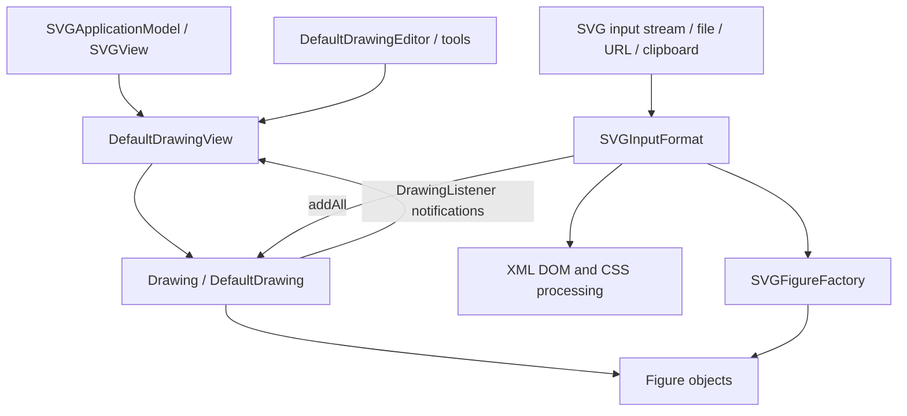
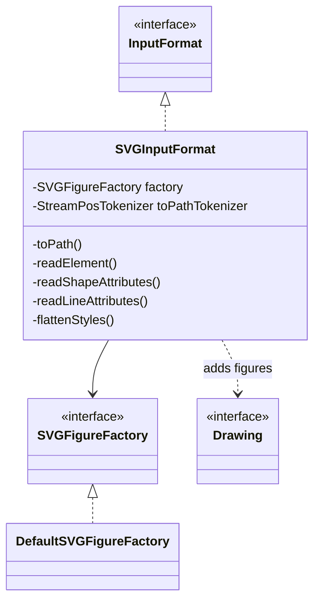
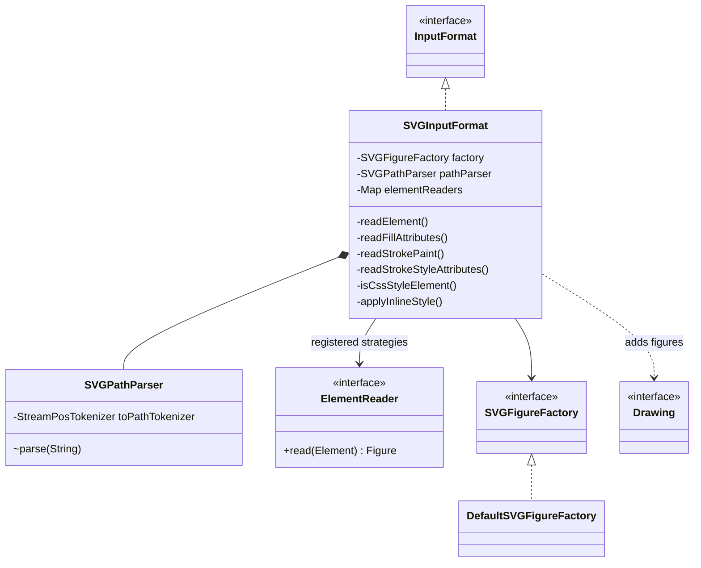

# JHotDraw architecture and SVG import design

Scope: Hassan's SVG import assignment in TASKS.md. Diagrams are selective source-level views, not exhaustive UML. Architecture is interpreted as MVC-like, not a claim of strict MVC.

## 1. Architecture (Phase 1)

The application layer configures the SVG application; the view displays drawings and handles selection; the editor coordinates tools; the drawing model stores figures and emits events. SVG import translates XML into figures through a factory and adds them to the drawing. The importer is not the UI controller.

## 2. Before structural refactoring

Baseline structural reference: parent of d3c4e1d (after initial characterization and bootstrap fix).

The importer combined path parsing, element dispatch, style handling and attribute processing. Long methods and duplicate line/shape logic made changes difficult.

## 3. After structural refactoring

Path parsing is delegated to a dedicated package-private class. ElementReader is a private nested functional interface, not a set of new concrete classes. Attribute and CSS helpers remain in the importer. The public InputFormat contract remains intact.

## 4. Design patterns found in original architecture

| Pattern | Participants and source evidence | Purpose |
|---|---|---|
| Factory (abstract-factory-style interface) | SVGFigureFactory, DefaultSVGFigureFactory, SVGInputFormat; factory.createRect and factory.createG | Decouple importer from concrete figure construction |
| Composite | Figure, CompositeFigure, GroupFigure, SVGGroupFigure; GroupFigure extends AbstractAttributedCompositeFigure | Treat groups and individual figures through common figure operations |
| Observer | Drawing, DrawingListener, DefaultDrawingView.EventHandler; setDrawing registers eventHandler via addDrawingListener | Notify view about model changes |
| Prototype | Figure.clone, SVGRectFigure.clone, SVGInputFormat use-reference cloning | Copy existing figures rather than reconstructing from scratch |
| MVC-like architecture | Drawing, DefaultDrawingView, DefaultDrawingEditor | Separate model, presentation and editing coordination |

## 5. Pattern introduced by refactoring

Strategy-style dispatch: SVGInputFormat.createElementReaders registers element names with ElementReader method references/lambdas; readElement selects a reader from the map and invokes reader.read(elem). This replaces the original conditional chain (commit 08825fa). It is a functional implementation of Strategy-like behavior, not a classical hierarchy of separate strategy classes. Unknown elements remain handled by the fallback.

## 6. Source evidence

- [SVG import package](https://github.com/shazilhamzah/JHotDraw-SRE-Project/tree/hassan-svg-refactoring/jhotdraw-src/jhotdraw-samples/jhotdraw-samples-misc/src/main/java/org/jhotdraw/samples/svg/io)
- [SVG figures](https://github.com/shazilhamzah/JHotDraw-SRE-Project/tree/hassan-svg-refactoring/jhotdraw-src/jhotdraw-samples/jhotdraw-samples-misc/src/main/java/org/jhotdraw/samples/svg/figures)
- [Drawing core](https://github.com/shazilhamzah/JHotDraw-SRE-Project/tree/hassan-svg-refactoring/jhotdraw-src/jhotdraw-core/src/main/java/org/jhotdraw/draw)
- [Extract parser](https://github.com/shazilhamzah/JHotDraw-SRE-Project/commit/d3c4e1d)
- [Reader strategies](https://github.com/shazilhamzah/JHotDraw-SRE-Project/commit/08825fa)
- [Attribute extraction](https://github.com/shazilhamzah/JHotDraw-SRE-Project/commit/ec548b2)
- [Parameterized helpers](https://github.com/shazilhamzah/JHotDraw-SRE-Project/commit/8d1f584)
- [CSS decomposition](https://github.com/shazilhamzah/JHotDraw-SRE-Project/commit/089f308)

These diagrams describe the assigned subsystem and its major architectural connections, not every JHotDraw module. No production code changed in this documentation commit. Mermaid rendering should be checked on GitHub.
