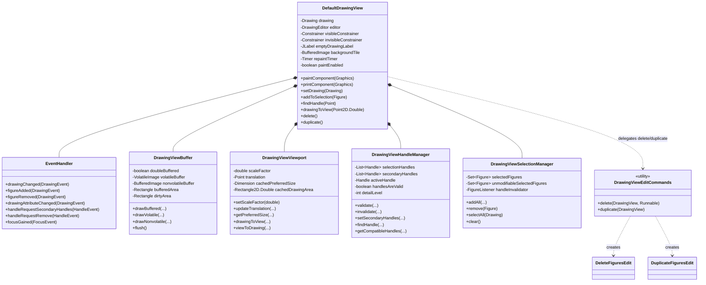

# Refactoring Log — `DefaultDrawingView`

Every step below followed the characterization-first discipline: characterization tests passed on unmodified `DefaultDrawingView.java` before Step 1, dedicated unit tests were added for each extracted class, and `mvn -pl jhotdraw-core -am test` (including Spotless + Checkstyle) passed after every step.

## Target Architecture

---

## Chronological Refactoring Steps

### Step 0 — Baseline Characterization Suite
- **Action:** Added [TestDrawingEditorStub.java](file:///C:/Users/MuhammadShazil/Documents/SRE%20Project/jhotdraw-src/jhotdraw-core/src/test/java/org/jhotdraw/draw/TestDrawingEditorStub.java), [DefaultDrawingViewUnitTest.java](file:///C:/Users/MuhammadShazil/Documents/SRE%20Project/jhotdraw-src/jhotdraw-core/src/test/java/org/jhotdraw/draw/DefaultDrawingViewUnitTest.java), and [DefaultDrawingViewIntegrationTest.java](file:///C:/Users/MuhammadShazil/Documents/SRE%20Project/jhotdraw-src/jhotdraw-core/src/test/java/org/jhotdraw/draw/DefaultDrawingViewIntegrationTest.java) against the unmodified `DefaultDrawingView.java`.
- **Verification:** `mvn -pl jhotdraw-core -am test` → **22/22 passed**, 0 Checkstyle violations.

### Step 3.1 — Extract Double-Buffering into `DrawingViewBuffer`
- **Catalog Refactorings Applied:**
  - *Extract Class*: Moved `isDrawingDoubleBuffered`, `drawingBufferV`, `drawingBufferNV`, `bufferedArea`, `dirtyArea`, `IS_WINDOWS`, and buffering logic into [DrawingViewBuffer.java](file:///C:/Users/MuhammadShazil/Documents/SRE%20Project/jhotdraw-src/jhotdraw-core/src/main/java/org/jhotdraw/draw/DrawingViewBuffer.java).
  - *Form Template Method / Extract Method*: Unified duplicated shift/dirty-rectangle tracking and offscreen rendering into `prepareBufferedArea(Rectangle, boolean)` and `renderDirtyRegion(...)`.
  - *Replace Magic Number with Symbolic Constant*: Extracted `TRANSPARENT_CLEAR = new Color(0x0, true)`.
- **Defects Addressed:** Fixed Defect #10 (headless `gc == null` fallback and zero-size `visibleRect` guard) and PMD `EmptyCatchBlock` / `AvoidCatchingThrowable` (`catch (SecurityException e)` with null-safe `os.name` check).
- **Tests Added:** [DrawingViewBufferTest.java](file:///C:/Users/MuhammadShazil/Documents/SRE%20Project/jhotdraw-src/jhotdraw-core/src/test/java/org/jhotdraw/draw/DrawingViewBufferTest.java) (4 tests).
- **Verification:** `mvn -pl jhotdraw-core -am test` → **26/26 passed**.

### Step 3.2 — Extract Coordinate Transforms & Layout Caching into `DrawingViewViewport`
- **Catalog Refactorings Applied:**
  - *Extract Class*: Moved `scaleFactor`, `translation`, `cachedDrawingArea`, `cachedPreferredSize`, coordinate conversions, canvas view bounds, preferred size, and translation logic into [DrawingViewViewport.java](file:///C:/Users/MuhammadShazil/Documents/SRE%20Project/jhotdraw-src/jhotdraw-core/src/main/java/org/jhotdraw/draw/DrawingViewViewport.java).
  - *Extract Method & Decompose Conditional*: Split `updateTranslation` into `computeInitialTranslation` and `clampTranslationToDrawing`; split `getPreferredSize` into `computeInfiniteCanvasPreferredSize` and `computeFixedCanvasPreferredSize`.
  - *Simplify Arithmetic Expression*: Replaced `Math.max(0, r.x) + r.width + Math.min(0, r.x)` with `r.x + r.width`.
- **Defects Addressed:** Fixed Defect #2 (swapped `insets.top` / `insets.left` and stale fixed-canvas offset), Defect #11-cache (`invalidateDimension()` in `setDrawing()`), and Defect #12 (`setScaleFactor` positive-finite validation and synchronous dimension invalidation).
- **Tests Added:** [DrawingViewViewportTest.java](file:///C:/Users/MuhammadShazil/Documents/SRE%20Project/jhotdraw-src/jhotdraw-core/src/test/java/org/jhotdraw/draw/DrawingViewViewportTest.java) (4 tests).
- **Verification:** `mvn -pl jhotdraw-core -am test` → **30/30 passed**.

### Step 3.3 — Extract Handle Lifecycle into `DrawingViewHandleManager`
- **Catalog Refactorings Applied:**
  - *Extract Class*: Moved `selectionHandles`, `secondaryHandles`, `activeHandle`, `handlesAreValid`, `detailLevel`, and all handle management methods into [DrawingViewHandleManager.java](file:///C:/Users/MuhammadShazil/Documents/SRE%20Project/jhotdraw-src/jhotdraw-core/src/main/java/org/jhotdraw/draw/DrawingViewHandleManager.java).
  - *Extract Method*: Extracted `populateSelectionHandles`, `disposeHandles`, and `unionArea`.
  - *Remove Dead Field*: Removed unused `secondaryHandleOwner`.
  - *Substitute Algorithm*: Replaced `while (true) { ... break; }` in `validateHandles` with a two-pass fallback check (eliminating PMD `AvoidBranchingStatementAsLastInLoop`).
- **Defects Addressed:** Fixed Defect #7 (`HANDLE_DETAIL_LEVEL_PROPERTY` bound notification in `setHandleDetailLevel`) and Defect #8 (listener detachment and disposal in `setSecondaryHandles` and `removeHandle`).
- **Tests Added:** [DrawingViewHandleManagerTest.java](file:///C:/Users/MuhammadShazil/Documents/SRE%20Project/jhotdraw-src/jhotdraw-core/src/test/java/org/jhotdraw/draw/DrawingViewHandleManagerTest.java) (3 tests).
- **Verification:** `mvn -pl jhotdraw-core -am test` → **33/33 passed**.

### Step 3.4 — Extract Figure Selection Management into `DrawingViewSelectionManager`
- **Catalog Refactorings Applied:**
  - *Extract Class*: Moved selection state and figure-listener lifecycle into [DrawingViewSelectionManager.java](file:///C:/Users/MuhammadShazil/Documents/SRE%20Project/jhotdraw-src/jhotdraw-core/src/main/java/org/jhotdraw/draw/DrawingViewSelectionManager.java).
  - *Rename Field*: Renamed `SELECTED_FIGURES` / `UNMODIFIABLE_SELECTED_FIGURES` to camelCase `selectedFigures` / `unmodifiableSelectedFigures`.
  - *Consolidate Duplicate Code*: Unified `addToSelection(Figure)` to delegate to `addToSelection(Collection<Figure>)` via `Collections.singletonList(figure)`.
- **Defects Addressed:** Fixed Defect #4 (`handleInvalidator` detachment in `clearSelection` / `selectAll` and attachment in `selectAll`) and Defect #5 (`drawing == null` guards in `selectAll`, `findFigure`, `findFigures`, `findFiguresWithin`).
- **Tests Added:** [DrawingViewSelectionManagerTest.java](file:///C:/Users/MuhammadShazil/Documents/SRE%20Project/jhotdraw-src/jhotdraw-core/src/test/java/org/jhotdraw/draw/DrawingViewSelectionManagerTest.java) (1 test).
- **Verification:** `mvn -pl jhotdraw-core -am test` → **34/34 passed**.

### Step 3.5 — Extract Undoable Edit Commands into `DrawingViewEditCommands`
- **Catalog Refactorings Applied:**
  - *Extract Class*: Moved `delete()` and `duplicate()` logic into [DrawingViewEditCommands.java](file:///C:/Users/MuhammadShazil/Documents/SRE%20Project/jhotdraw-src/jhotdraw-core/src/main/java/org/jhotdraw/draw/DrawingViewEditCommands.java).
  - *Replace Anonymous Inner Class with Named Class*: Converted anonymous `AbstractUndoableEdit` subclasses into static named classes `DeleteFiguresEdit` and `DuplicateFiguresEdit`.
  - *Replace Magic Number with Symbolic Constant*: Extracted `DUPLICATE_OFFSET_X = 5`, `DUPLICATE_OFFSET_Y = 5`, `LABELS_BUNDLE`.
- **Defects Addressed:** Fixed Defect #5 & #9 (early return on null drawing or empty selection; consistent captured `targetDrawing` inside undo/redo edits).
- **Tests Added:** [DrawingViewEditCommandsTest.java](file:///C:/Users/MuhammadShazil/Documents/SRE%20Project/jhotdraw-src/jhotdraw-core/src/test/java/org/jhotdraw/draw/DrawingViewEditCommandsTest.java) (3 tests).

### Step 3.6 — Clean Up `DefaultDrawingView`, Rendering Helpers, Event Safety & Final Verification
- **Catalog Refactorings Applied:**
  - *Extract Method*: Extracted `applyRenderingHints(Graphics2D, boolean)`, `drawWithViewTransform(Graphics2D, Consumer<Graphics2D>)`, `drawInfiniteCanvasBackground(Graphics2D)`, `fillFullViewWithBackgroundTile(Graphics2D, int, int)`, and `createTranslucentCanvasColor(Color, double)`.
  - *Replace Magic Number with Symbolic Constant*: Extracted `DEFAULT_BACKGROUND_COLOR`, `CHECKER_DARK_COLOR`, `CHECKER_TILE_SIZE`, `CHECKER_CELL_SIZE`, `REPAINT_MARGIN`, `SET_DRAWING_REPAINT_DELAY_MS`, `RGB_COLOR_MASK`, `MAX_ALPHA`, and used `DrawingView.SCALE_FACTOR_PROPERTY`.
  - *Remove Dead Code*: Removed obsolete NetBeans `editor-fold` / `Variables declaration` boilerplate, obsolete `FIXME` comments, and commented-out code in `EventHandler`.
  - *Remove Redundant Field*: Removed duplicate `cachedPreferredSize` from `DefaultDrawingView` after `DrawingViewViewport` took over preferred-size caching.
- **Defects Addressed:** Fixed Defect #1 (`0xffffff` mask + clamped `Math.round`), Defect #3 (`addNotify`/`removeNotify` `"editor"` property change), Defect #6 (null-safe `CANVAS_HEIGHT.equals(a)` and `repaintDrawingArea(e.getInvalidatedArea())`), and Defect #11 (`repaintTimer` cancellation and `paintEnabled = true` before `repaint()`).
- **Tests Added:** [DefaultDrawingViewDefectFixesTest.java](file:///C:/Users/MuhammadShazil/Documents/SRE%20Project/jhotdraw-src/jhotdraw-core/src/test/java/org/jhotdraw/draw/DefaultDrawingViewDefectFixesTest.java) (12 tests, one per defect).
- **Verification:** Full multi-module `mvn test` across all 13 reactor modules → **BUILD SUCCESS**, **49/49 tests passed in `jhotdraw-core`**, **0 Checkstyle violations**, **0 PMD violations** on `DefaultDrawingView` and all 5 extracted classes.

---

## API Backward-Compatibility Guarantees

All existing `public` and `protected` members of `DefaultDrawingView` (`DrawingView`, `EditableComponent`, `DRAWING_DOUBLE_BUFFERED_PROPERTY`, `backgroundTile`, `EventHandler`, `createEventHandler()`, `drawBackground`, `drawCanvas`, `drawConstrainer`, `drawDrawing`, `drawHandles`, `drawTool`, `drawDrawingVolatileBuffered`, `drawDrawingNonvolatileBuffered`, `getCanvasViewBounds`, `getBackgroundPaint`, `getDrawingArea`, `invalidateDimension`, `fireSelectionChanged`, `fireViewTransformChanged`, `setViewRenderingHints`, `repaintDrawingArea`, `setEmptyDrawingMessage`, `getEmptyDrawingMessage`, `setDrawingDoubleBuffered`, `isDrawingDoubleBuffered`) retain their exact signatures and visibility so all downstream modules (`jhotdraw-samples-misc`, `jhotdraw-samples-mini`, etc.) compile and work without changes.
